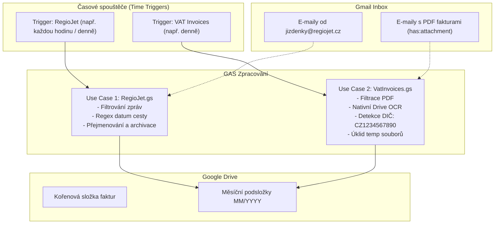

# Specifikace a koncept automatizací (Use Cases)

Tento dokument slouží jako detailní architektonická specifikace a podklad pro domýšlení, rozvoj a implementaci automatizačních skriptů v projektu **Self Automation**.

---

## Přehled systému a infrastruktury

- **Prostředí:** Google Apps Script (GAS) napojený na Google Workspace (Gmail, Google Drive, Google Docs).
- **Vývoj a deployment:** Lokální vývoj přes `@google/clasp`, verzování přes Git/GitHub.
- **Spouštění:** Nezávislé časové spouštěče (Time-driven triggers) pro jednotlivé procesy.
- **Konfigurace:** Citlivé a variabilní hodnoty (ID složek, DIČ, štítky) oddělené do konfigurace (`PropertiesService`).



---

## Use Case 1: Zpracování jízdenek a faktur RegioJet (`RegioJet.gs`)

### 1.1 Kontext a cíl
Automatické stahování, inteligentní přejmenování a ukládání daňových dokladů/jízdenek z e-mailů od společnosti RegioJet na Google Disk do složek rozčleněných podle měsíců a roků, s následnou archivací e-mailu.

### 1.2 Parametry a filtry
| Parametr | Hodnota | Poznámka |
| :--- | :--- | :--- |
| **Spouštění** | Periodický časový trigger | Doporučeno 1× denně (např. v noci) nebo 1× za několik hodin |
| **Odesílatel** | `jizdenky@regiojet.cz` | Přesná adresa odesílatele |
| **Předmět zprávy** | `RegioJet: Elektronická jízdenka` | Klíčová fráze v předmětu |
| **Podmínka přílohy** | Název obsahuje `invoice` | Case-insensitive (PDF doklad s fakturou) |
| **Časové okno** | `after:YYYY/MM/DD` | Omezení na aktuální den spuštění |
| **Vylučovací filtr** | `-label:Processed_RJ` | Zabrání opakovanému zpracování stejného vlákna |
| **Kořenová složka Drive** | `YOUR_DRIVE_FOLDER_ID` | Cílová mateřská složka |
| **Cílová podsložka** | `MM/YYYY` (např. `10/2026`) | Vytvoří se dynamicky podle aktuálního data |

### 1.3 Logika zpracování
1. **Ověření / vytvoření štítku:** Skript zkontroluje existenci štítku `Processed_RJ` v Gmailu (pokud neexistuje, vytvoří jej).
2. **Vyhledání zpráv:** Sestaví vyhledávací dotaz:
   ```text
   from:jizdenky@regiojet.cz subject:"RegioJet: Elektronická jízdenka" filename:invoice after:YYYY/MM/DD -label:Processed_RJ
   ```
3. **Iterace přes zprávy a přílohy:**
   - Z předmětu zprávy extrahuje datum cesty pomocí regulárního výrazu: `(\d{2}\.\d{2})`.
   - Projde přílohy, které obsahují v názvu `invoice`.
   - Vytvoří nový normalizovaný název souboru: `RJ_DD.MM.{přípona}` (při nenalezení data ponechá původní název přílohy).
4. **Uložení na Google Disk:**
   - Získá nebo vytvoří podsložku `MM/YYYY` pod definovanou kořenovou složkou.
   - Uloží zkopírovaný blob do cílové složky s novým názvem.
5. **Označení a úklid v Gmailu:**
   - Celému vláknu přiřadí štítek `Processed_RJ`.
   - Vlákno archivuje (`thread.moveToArchive()`), aby nezůstávalo v doručené poště.

### 1.4 Body k domyšlení a diskuzi (Brainstorming)
- [ ] **Časové okno `after:YYYY/MM/DD` vs. přelom půlnoci:**
  Pokud jízdenka dorazí ve 23:55 a trigger se spustí v 00:05, filtr `after:YYYY/MM/DD` (kde datum je už nový den) může e-mail minout. Bezpečnější by mohlo být `newer_than:2d -label:Processed_RJ`.
- [ ] **Kolize názvů souborů:**
  Pokud uživatel cestuje v jeden den dvakrát (tam i zpět), obě jízdenky by dostaly stejný název `RJ_18.10.pdf`.
  *Návrh řešení:* Přidat kontrolu existence souboru nebo do názvu zahrnout kód rezervace / čas či suffix `RJ_18.10_1.pdf`.
- [ ] **Přiřazení do složky podle data jízdy vs. data vystavení:**
  Pokud v říjnu kupuji jízdenku na prosinec, má být ve složce `10/2026` (účetní datum vystavení dokladu) nebo `12/2026` (datum cesty)? Pro účetnictví bývá klíčové datum vystavení (aktuální měsíc).

---

## Use Case 2: Obecné přijaté faktury podle DIČ s využitím OCR (`VatInvoices.gs`)

### 2.1 Kontext a cíl
Plně autonomní robot, který monitoruje příchozí poštu, vyhledává PDF dokumenty od libovolných dodavatelů a pomocí nativního Google OCR v nich vyhledává DIČ uživatele jako odběratele (`CZ1234567890`). Úspěšně ověřené daňové doklady ukládá do účetní složky na Google Disku.

### 2.2 Parametry a filtry
| Parametr | Hodnota | Poznámka |
| :--- | :--- | :--- |
| **Spouštění** | Periodický časový trigger (např. 1× denně) | Vyžaduje ohled na limity doby běhu skriptu |
| **Hledané DIČ** | `CZ1234567890` | Validace s normalizací (odstranění mezer, nerozlišování velkých/malých písmen) |
| **Formát příloh** | `application/pdf` | Vyhodnocují se pouze PDF soubory |
| **Vyhledávací dotaz** | `has:attachment filename:pdf -label:Invoices/Processed -label:Invoices/Ignored newer_than:7d` | Okno 7 dní s vyloučením již prošlých e-mailů |
| **Štítky Gmail** | `Invoices/Processed`, `Invoices/Ignored` | Zajišťují idempotenci a stavové řízení |

### 2.3 Strategie OCR a čtení dokumentu
Google Apps Script umožňuje využít OCR integrované přímo v Google Disku bez externích zpoplatněných služeb (Google Cloud Vision API apod.):
1. **Konverze PDF -> Google Dokument:**
   - Využívá se pokročilá služba **Drive API (v2)**:
     ```javascript
     const fileMetadata = {
       title: "temp_ocr_" + new Date().getTime(),
       mimeType: "application/vnd.google-apps.document"
     };
     const tempDoc = Drive.Files.insert(fileMetadata, pdfBlob, {
       ocr: true,
       ocrLanguage: "cs" // Čeština pro správnou diakritiku
     });
     ```
2. **Extrakce textu:**
   - Text je načten pomocí standardní služby `DocumentApp`:
     ```javascript
     const doc = DocumentApp.openById(tempDoc.id);
     const fullText = doc.getBody().getText();
     ```
3. **Normalizace a ověření DIČ:**
   - Text i hledané DIČ se zbaví mezer a pomlček:
     ```javascript
     const normalizedText = fullText.replace(/\s+/g, "").toUpperCase();
     const isMatch = normalizedText.includes("CZ1234567890");
     ```
4. **Garantovaný úklid (Garbage Collection):**
   - Vytvořený Google Dokument **musí** být vždy smazán v bloku `finally`:
     ```javascript
     try {
       // OCR logika...
     } finally {
       if (tempDocId) {
         DriveApp.getFileById(tempDocId).setTrashed(true);
       }
     }
     ```

### 2.4 Životní cyklus e-mailů a zpracování neshod (Edge Cases & Fallbacks)
Detailní popis toho, co se přesně stane s e-maily podle obsahu příloh a výsledku OCR testu:

| Typ e-mailu / Scénář | Gmail vyhledávací filtr | Spuštění OCR | Akce na Google Disku | Štítek v Gmailu | Výsledné umístění v Gmailu |
| :--- | :--- | :--- | :--- | :--- | :--- |
| **E-mail bez přílohy** | ❌ Vyřazen filtrem (`has:attachment`) | ❌ Ne | Žádná | Žádný | Zůstává beze změny v Doručené poště |
| **E-mail s jinou přílohou (ZIP, PNG...)** | ❌ Vyřazen filtrem (`filename:pdf`) | ❌ Ne | Žádná | Žádný | Zůstává beze změny v Doručené poště |
| **E-mail s PDF, ale DIČ nenalezeno** | ✔️ Projde filtrem | ✔️ Ano | Žádná | `Invoices/Ignored` | Zůstává v Doručené poště (nearchivuje se) |
| **E-mail s PDF a nalezeným DIČ** | ✔️ Projde filtrem | ✔️ Ano | Uložení do `MM/YYYY` | `Invoices/Processed` | Archivováno / Zpracováno |

#### Detailní chování při absenci DIČ (Prevence re-processing smyčky):
1. **Riziko při neoznačení:**
   - Pokud by e-mail s PDF neobsahoval vaše DIČ a skript by mu nepřidal žádný štítek, při každém dalším běhu triggeru (např. každou noc) by e-mail znovu prošel filtrem `newer_than:7d`.
   - Skript by na něm opakovaně prováděl časově i výpočetně náročné OCR, což by rychle vyčerpalo časové limity GAS (6 minut na běh).
2. **Ochrana štítkem `Invoices/Ignored`:**
   - Jakmile skript projde všechna PDF v daném e-mailu a ani v jednom nenajde DIČ `CZ1234567890`, přiřadí celému vláknu štítek `Invoices/Ignored`.
   - E-mail se **nemaže ani nearchivuje** — uživatel jej stále vidí v doručené poště (např. leták, bankovní výpis, běžná komunikace).
   - Vyhledávací filtr `-label:Invoices/Ignored` zajistí, že v jakémkoliv příštím běhu skript tento e-mail okamžitě přeskočí bez provádění OCR.
3. **Možnost manuálního re-scanu:**
   - Pokud by uživatel chtěl, aby skript e-mail přehodnotil (např. po úpravě regexu či logiky), stačí v Gmailu štítek `Invoices/Ignored` jednoduše odebrat.

### 2.5 Body k domyšlení a diskuzi (Brainstorming)
- [ ] **Limity Google Apps Scriptu (Quota & Execution Time):**
  - Běžný bezplatný Google účet má limit **6 minut** na jeden běh skriptu.
  - OCR konverze trvá typicky 2–5 sekund na jedno PDF.
  - *Řešení:* Zpracovávat maximálně např. 5–10 vláken v jedné dávce (batch processing) s bezpečnostním časovým limitem.
- [ ] **Rozlišení odběratel vs. dodavatel:**
  - Co když vystavíte fakturu vy někomu jinému a máte ji v odeslané/přijaté poště? Vaše DIČ tam bude figurovat jako *dodavatel*.
  - *Řešení:* Hledat kontext klíčových slov v okolí DIČ (např. *Odběratel / Kupující / Příjemce / Customer* vs. *Dodavatel / Poskytovatel*), případně omezit vyhledávání pouze na příchozí poštu (`to:me` nebo `-from:me`).
- [ ] **Aktivace pokročilé služby Drive v manifestu:**
  - V `appsscript.json` musí být explicitně povoleno `Drive` API v `dependencies.enabledAdvancedServices`.
- [ ] **Inteligentní pojmenování uložených faktur:**
  - Místo původního `faktura_12345.pdf` zkusit z OCR vytáhnout název dodavatele nebo IČO a datum, případně ukládat s prefixem `FA_{YYYY-MM-DD}_{PůvodníNázev}`.

---

## Společné standardy a sdílená architektura

### Konfigurace (`ScriptProperties`)
Místo natvrdo vepsaných řetězců v kódu ukládat konfiguraci do `PropertiesService.getScriptProperties()`:
```javascript
const CONFIG = {
  INVOICE_ROOT_FOLDER_ID: PropertiesService.getScriptProperties().getProperty("INVOICE_ROOT_FOLDER_ID") || "YOUR_DRIVE_FOLDER_ID",
  TARGET_VAT_ID: PropertiesService.getScriptProperties().getProperty("TARGET_VAT_ID") || "CZ1234567890",
  MAX_OCR_BATCH_SIZE: 8
};
```

### Struktura souborů v projektu
```text
self-automatization/
├── .clasp.json               # Konfigurace Clasp
├── .gitignore                # Ignorování node_modules a systémových souborů
├── README.md                 # Přehled projektu a návod k vývoji
├── USE_CASES.md              # Tato specifikace use-casů a architektury
├── appsscript.json           # Manifest projektu (včetně Drive Advanced Service)
├── package.json              # Typové definice pro autocomplete
├── src/
│   ├── Config.js             # Globální konfigurace a konstanty
│   ├── DriveUtils.js         # Sdílená práce se složkami na Disku (MM/YYYY)
│   ├── RegioJet.js           # Use Case 1: Implementace RegioJet
│   └── VatInvoices.js        # Use Case 2: Implementace OCR a filtrace podle DIČ
```

---

## Návrh dalších kroků (Action Plan)
1. **Ověření a odsouhlasení specifikace** (připomínky k vyhledávacím filtrům a OCR logice).
2. **Povolení Drive API v `appsscript.json`** pro podporu nativního OCR.
3. **Refaktoring adresářové struktury / rozdělení souborů** na čisté moduly.
4. **Implementace a otestování** Use Case 1 a Use Case 2.
