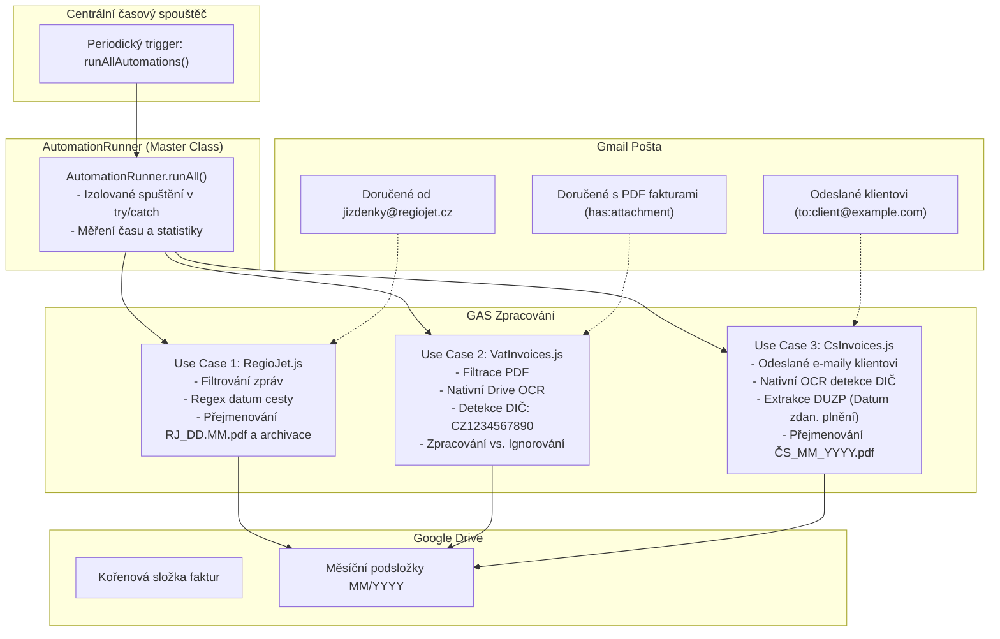

# Specifikace a koncept automatizací (Use Cases)

Tento dokument slouží jako detailní architektonická specifikace a podklad pro domýšlení, rozvoj a implementaci automatizačních skriptů v projektu **Self Automation**.

---

## Přehled systému a infrastruktury

- **Prostředí:** Google Apps Script (GAS) napojený na Google Workspace (Gmail, Google Drive, Google Docs).
- **Vývoj a deployment:** Lokální vývoj přes `@google/clasp`, verzování přes Git/GitHub.
- **Centrální spouštění (Orchestrace):** Jediný centrální časový spouštěč (Time-driven trigger) spouštějící třídu `AutomationRunner.runAll()`.
- **Konfigurace:** Citlivé a variabilní hodnoty (ID složek, DIČ, štítky, klientské e-maily) oddělené do konfigurace (`PropertiesService`).



---

## Use Case 1: Zpracování jízdenek a faktur RegioJet (`RegioJet.js`)

### 1.1 Kontext a cíl
Automatické stahování, inteligentní přejmenování a ukládání daňových dokladů/jízdenek z e-mailů od společnosti RegioJet na Google Disk do složek rozčleněných podle měsíců a roků, s následnou archivací e-mailu.

### 1.2 Parametry a filtry
| Parametr | Hodnota | Poznámka |
| :--- | :--- | :--- |
| **Spouštění** | Součást `runAllAutomations()` | Spouštěno centrálním triggerem |
| **Odesílatel** | `jizdenky@regiojet.cz` | Přesná adresa odesílatele |
| **Předmět zprávy** | `RegioJet: Elektronická jízdenka` | Klíčová fráze v předmětu |
| **Podmínka přílohy** | Název obsahuje `invoice` | Case-insensitive (PDF doklad s fakturou) |
| **Časové okno** | `newer_than:7d` | Sjednocené 7denní okno |
| **Vylučovací filtr** | `-label:Processed_RJ` | Zabrání opakovanému zpracování stejného vlákna |
| **Kořenová složka Drive** | `INVOICE_ROOT_FOLDER_ID` | Čteno ze Script Properties |
| **Cílová podsložka** | `MM/YYYY` (např. `10/2026`) | Vytvoří se dynamicky podle data e-mailu |

### 1.3 Logika zpracování
1. Ověří existenci štítku `Processed_RJ`.
2. Vyhledá odpovídající zprávy v okně 7 dní.
3. Extrahuje datum cesty z předmětu zprávy pomocí regexu: `(\d{2}\.\d{2})`.
4. Uloží fakturu do podsložky `MM/YYYY` pod názvem `RJ_DD.MM.{ext}` s ochranou proti přepsání.
5. Vláknu přiřadí štítek `Processed_RJ` a vlákno archivuje (`thread.moveToArchive()`).

---

## Use Case 2: Obecné přijaté faktury podle DIČ s využitím OCR (`VatInvoices.js`)

### 2.1 Kontext a cíl
Plně autonomní robot, který monitoruje příchozí poštu, vyhledává PDF dokumenty od libovolných dodavatelů a pomocí nativního Google OCR v nich vyhledává DIČ uživatele jako odběratele (`CZ1234567890`). Úspěšně ověřené daňové doklady ukládá do účetní složky na Google Disku.

### 2.2 Parametry a filtry
| Parametr | Hodnota | Poznámka |
| :--- | :--- | :--- |
| **Spouštění** | Součást `runAllAutomations()` | Spouštěno centrálním triggerem |
| **Hledané DIČ** | `TARGET_VAT_ID` | Čteno ze Script Properties, normalizované porovnání |
| **Formát příloh** | `application/pdf` | Vyhodnocují se pouze PDF soubory |
| **Vyhledávací dotaz** | `has:attachment filename:pdf -label:Invoices/Processed -label:Invoices/Ignored newer_than:7d` | Okno 7 dní s vyloučením hotových |
| **Štítky Gmail** | `Invoices/Processed`, `Invoices/Ignored` | Zajišťují idempotenci a stavové řízení |

### 2.3 Životní cyklus e-mailů a zpracování neshod
- **E-mail bez přílohy / bez PDF:** Gmail filtr ho vůbec nepropustí, skript se ho nedotkne.
- **E-mail s PDF, kde DIČ NENÍ:** Projde OCR, dostane štítek `Invoices/Ignored` (aby se v příštích 7 dnech neskenoval znova) a **zůstává v doručené poště** bez archivace.
- **E-mail s PDF, kde DIČ JE:** Uloží PDF do složky `MM/YYYY`, dostane štítek `Invoices/Processed` a **archivuje se**.

---

## Use Case 3: Vydané faktury Česká spořitelna (`CsInvoices.js`)

### 3.1 Kontext a cíl
Automatické zpracování **odeslaných e-mailů** obsahujících vydanou fakturu pro klienta Česká spořitelna. Skript ověří přítomnost vašeho DIČ jako dodavatele, z textu faktury vyčte **Datum zdanitelného plnění (DUZP)** a uloží doklad do příslušné měsíční složky pod jednotným názvem např. `ČS_09_2026.pdf`.

### 3.2 Parametry a filtry
| Parametr | Hodnota | Poznámka |
| :--- | :--- | :--- |
| **Spouštění** | Součást `runAllAutomations()` | Spouštěno centrálním triggerem |
| **Příjemce e-mailu** | `CS_INVOICE_RECIPIENT_EMAIL` | Čteno ze Script Properties (např. klientská účtárna/kontaktní osoba) |
| **Hledané DIČ** | `TARGET_VAT_ID` | Vaše DIČ uvedené na faktuře jako dodavatel |
| **Časové okno** | `newer_than:30d` | 30 dní pro spolehlivé zachycení měsíční fakturace |
| **Vyhledávací dotaz** | `to:{email} has:attachment filename:pdf -label:Invoices/Processed_CS -label:Invoices/Ignored_CS newer_than:30d` | |
| **Štítky Gmail** | `Invoices/Processed_CS`, `Invoices/Ignored_CS` | Evidence zpracovaných odeslaných zpráv |
| **Prefix souboru** | `ČS` | Výsledný název např. `ČS_09_2026.pdf` |

### 3.3 Logika zpracování a extrakce DUZP
1. **Vyhledání zpráv:** Vyhledá odeslané zprávy na specifikovaný klientský e-mail s PDF přílohou bez štítku zpracování.
2. **Nativní OCR čtení:** Převede PDF na dočasný dokument a získá kompletní text faktury.
3. **Ověření DIČ:** Zkontroluje přítomnost vašeho DIČ v textu faktury.
4. **Určení data zdanitelného plnění (DUZP):**
   - Skript analyzuje text faktury pomocí regexu:
     `/(?:datum\s+(?:uskutečnění\s+)?zdanitelného\s+plnění|datum\s+zdan\.?\s*plnění|duzp)[\s:]*([0-3]?\d)\s*[.\/-]\s*([0-1]?\d)\s*[.\/-]\s*(20\d{2})/i`
   - Pokud je DUZP nalezeno (např. `30.09.2026`), extrahuje se měsíc `09` a rok `2026`.
   - Pokud DUZP v textu chybí, použije se jako bezpečný fallback datum odeslání zprávy.
5. **Cílová složka a pojmenování:**
   - Cílová složka na Disku se zvolí přesně podle určeného měsíce a roku: `MM/YYYY` (např. `09/2026`).
   - Název souboru je zformátován jako `ČS_{MM}_{YYYY}.pdf` (např. `ČS_09_2026.pdf`).
   - Pokud soubor s tímto názvem již existuje, funkce `saveFileSafe` automaticky přidá číselný index (`_1`, `_2`).
6. **Označení štítkem:** Vláknu se přiřadí štítek `Invoices/Processed_CS`.

---

## Centrální Orchestrátor (`AutomationRunner.js`)

Místo nastavování tří samostatných časových spouštěčů v Google Apps Scriptu existuje jediná nadřazená třída:

```javascript
class AutomationRunner {
  static runAll() {
    // 1. RegioJet jízdenky a faktury (izolovaný běh)
    // 2. Přijaté faktury podle DIČ (izolovaný běh)
    // 3. Vydané faktury Česká spořitelna (izolovaný běh)
  }
}

function runAllAutomations() {
  AutomationRunner.runAll();
}
```

### Výhody centrálního spouštěče:
- **Jediný Trigger:** Stačí nastavit 1 časový trigger v Google Apps Scriptu na funkci `runAllAutomations` (např. 1× za 6 hodin nebo 1× denně).
- **Izolace chyb:** Každá úloha běží v samostatném bloku `try-catch`. Pokud by např. u jednoho use casu nastal problém, ostatní automatizace se bez přerušení provedou.
- **Jednotný monitoring:** Detailní logování doby běhu jednotlivých úloh i celkového času dávky.

---

## Struktura souborů v projektu

```text
self-automatization/
├── .clasp.json               # Konfigurace Clasp (v .gitignore)
├── .clasp.json.example       # Veřejná šablona konfigurace Clasp
├── .gitignore                # Ignorování lokálních skriptů a systémových souborů
├── README.md                 # Přehled projektu a návod k prvnímu spuštění
├── USE_CASES.md              # Tato kompletní specifikace use-casů a architektury
├── appsscript.json           # Manifest projektu (včetně povolené služby Drive v2)
├── package.json              # Typové definice pro autocomplete v editoru
├── Config.js                 # Globální konfigurace a konstanty
├── DriveUtils.js             # Utility pro Google Disk, OCR a parsování DUZP
├── AutomationRunner.js       # Master Orchestrator (třída a vstupní bod runAllAutomations)
├── RegioJet.js               # Use Case 1: Implementace RegioJet
├── VatInvoices.js            # Use Case 2: Implementace přijatých faktur s OCR
├── CsInvoices.js             # Use Case 3: Implementace vydaných faktur ČS
└── setup.local.js            # Lokální skript pro nastavení Script Properties (v .gitignore)
```